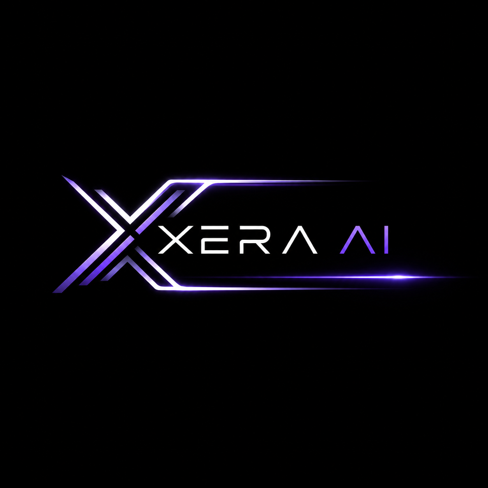
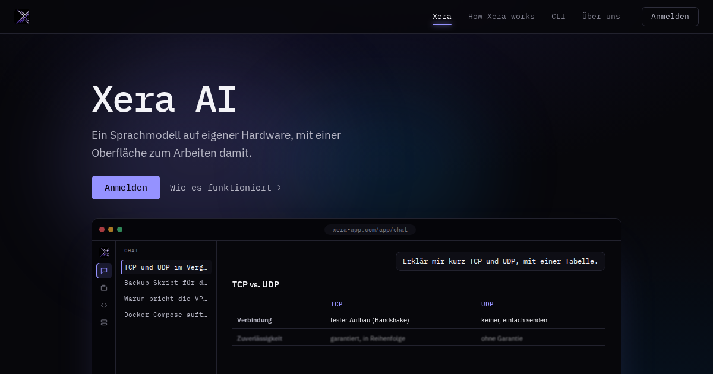
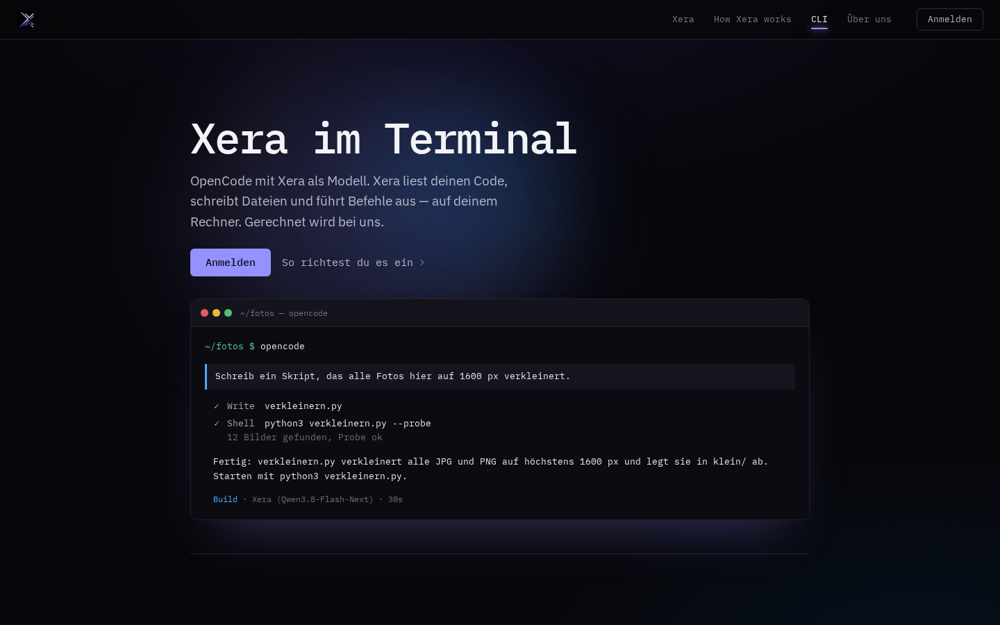

<p align="center">
  
</p>

<h1 align="center">Xera AI</h1>

<p align="center">
  <strong>Ein Sprachmodell auf eigener Hardware, mit einer Oberfläche zum Arbeiten damit.</strong>
</p>

<p align="center">
  <a href="https://github.com/Mentox07/xera-ai/actions/workflows/ci.yml"></a>
  <a href="LICENSE"></a>
  
  
</p>

<p align="center">
  <a href="https://xera-app.com">xera-app.com</a> &nbsp;·&nbsp;
  <a href="https://xera-app.com/app/cli">Xera im Terminal</a>
</p>

<p align="center">
  
</p>

---

## Was Xera ist

Ein Lern- und Homelab-Projekt: ein offenes Sprachmodell läuft mit llama.cpp auf eigenen Grafikkarten, darum herum
eine Web-Oberfläche zum Arbeiten. Fragen gehen an kein fremdes KI-Unternehmen. Anmeldung über Discord.

| Bereich | Was er tut |
|---|---|
| **Chat** | Fragen, Recherche über eine eigene SearXNG-Instanz, Dokumente lesen, Denkaufwand per `/effort` |
| **Cowork** | Ein Arbeitsbereich je Vorhaben — Dateien, Notizen, Gespräche, Agents, die mitarbeiten |
| **Code** | [OpenCode](https://github.com/anomalyco/opencode) auf dem Server, je Nutzer im Sandkasten; Webseiten und Spiele testet Xera im Browser |
| **Homelab** | Server und Container verwalten — nur mit Rolle, Eingriffe mit Freigabe |
| **CLI** | OpenCode auf dem eigenen Rechner mit Xera als Modell (`/v1`, OpenAI-kompatibel) — Dateien und Befehle bleiben lokal |

<p align="center">
  
</p>

## Aufbau

```
backend/        FastAPI — Anmeldung, Gespräche, Agents, Sandkasten, OpenCode-Motor, /v1 für die CLI
web/            Oberfläche (React, TypeScript, Vite)
neubau-agents/  Manifeste und Prompts der Agents
cli/            Konfiguration und Regeln für OpenCode (ausgeliefert unter /cli/…)
motor/          Sandkasten für den Code-Bereich: Shell ohne Netz, nftables-Sperre je Sandkasten-Benutzer
```

```
Browser ──► Reverse Proxy ──► FastAPI ──► llama.cpp (GPU-Server)
                                 │
                                 ├─ Code-Bereich: OpenCode je Nutzer, eigene Kennung, ohne Netz
                                 └─ /v1 ◄── OpenCode auf deinem Rechner (CLI, mit Schlüssel)
```

Was nur eine bestimmte Installation betrifft — Zugangsdaten, Adressen, SSH-Ziele —, steht nicht im Quelltext,
sondern in `.env` (Vorlage [`.env.example`](.env.example)) und in einer Standort-Datei
(Vorlage [`standort.example.json`](standort.example.json)).

## Sicherheit in Kürze

* **Sandkasten je Nutzer:** eigene, fest vergebene Benutzerkennung, Werkzeuge ohne Netz, Grenzen für CPU, Speicher,
  Dateigrösse und Platz; eine nftables-Regel erlaubt Sandkasten-Benutzern nur das Backend.
* **Rollen** (Pro, Admin, Homelab) kommen aus Discord, über ihre IDs, und werden alle 15 Minuten nachgeprüft.
* **CLI-Schlüssel** nur als SHA-256, jederzeit widerrufbar; Grenzen je Nutzer, Sperre nach falschen Schlüsseln.
* **Kopfzeilen:** CSP ohne Inline-Skripte, HSTS, kein Einbetten; Antworten laden keine fremden Bilder.

Lücken bitte vertraulich melden — siehe [SECURITY.md](SECURITY.md).

## Entwickeln

```bash
pip install -r requirements.txt
python -m compileall -q backend

cd web && npm ci && npm run build        # Typen prüfen und bauen
XERA_BACKEND=http://127.0.0.1:8000 npm run dev
```

Xera ist für ein eigenes Homelab gebaut und nicht als Installationspaket gedacht — der Code liegt offen, damit man
nachlesen kann, was mit den Eingaben geschieht.

## Lizenz

[MIT](LICENSE). OpenCode, das Programm hinter dem Code-Bereich und der CLI, steht ebenfalls unter MIT:
[github.com/anomalyco/opencode](https://github.com/anomalyco/opencode).
